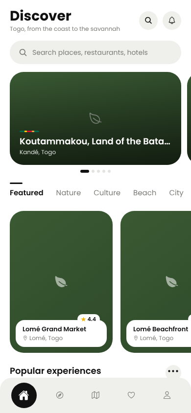
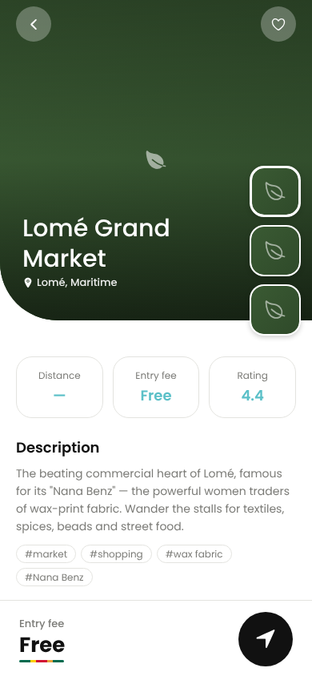
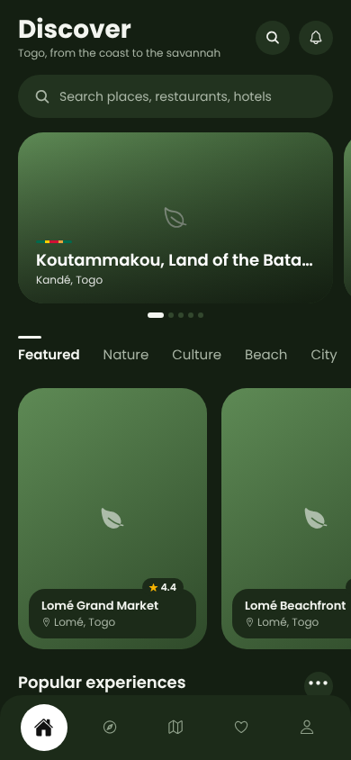

# Discover Togo 🇹🇬

A tourism platform for Togo: places to visit, restaurants, hotels and cultural experiences across all five regions. It has three parts:

| Part | Stack | Folder |
|---|---|---|
| 📱 Mobile app (iOS + Android) | Expo React Native, TypeScript, expo-router, TanStack Query, i18next, Firebase Auth, Google Maps | [`mobile/`](mobile) |
| 🛠 REST API | Node 22, Express 5, MongoDB, Firebase Admin, zod | [`backend/`](backend) |
| 🖥 Admin dashboard (web) | React, Vite, TypeScript, react-hook-form, zod | [`admin/`](admin) |

<p>
  
  
  
  
</p>

> In these screenshots, photos show the green fallback because the build sandbox blocked the image CDN. The seed data uses placeholder stock photos; replace them with licensed photos of each site.

## Run everything locally (no cloud accounts needed)

Start the API. It uses an in-memory store with Togo seed data and dev auth:

```bash
cd backend && npm install && cp .env.example .env && npm run dev
```

Start the admin dashboard at http://localhost:5173 (dev login enabled):

```bash
cd admin && npm install && cp .env.example .env && npm run dev
```

Start the mobile app (Expo Go / simulator, or press `w` for web):

```bash
cd mobile && npm install && cp .env.example .env && npx expo start
```

Google Maps and push notifications need a development build (`npx expo run:ios` / `run:android`). See each folder's README for production setup (MongoDB, Firebase, API keys).

## Documentation

| Doc | Contents |
|---|---|
| [docs/ARCHITECTURE.md](docs/ARCHITECTURE.md) | System architecture, navigation flow, screen-by-screen breakdown, monetization hooks |
| [docs/API.md](docs/API.md) | REST contract: endpoints, shapes, errors, rate limits, validation rules |
| [docs/DATABASE.md](docs/DATABASE.md) | MongoDB schema, indexes, future collections |
| [docs/SECURITY.md](docs/SECURITY.md) | Threat model and every protective layer, with tests |
| [firebase/](firebase) | Storage and Firestore rules, console hardening checklist |

## Features

- **Home:** hero, search, featured destinations, top restaurants and hotels, experiences, categories, personalised recommendations.
- **Places / restaurants / hotels:** region, city, category, cuisine, price and rating filters. Detail pages with gallery, map, hours, fees, menu, amenities, contact, booking and reviews.
- **Search and discovery:** global search, plus recommendations based on behaviour, popularity and location.
- **Accounts:** email and Google sign-in, profile, saved places, recently viewed, preferences, account deletion.
- **Offline mode:** persisted cache plus "save for offline".
- **Map view:** clickable pins.
- **Languages and themes:** EN/FR (local languages can be added), dark and light mode.
- **Admin:** CRUD for listings, review moderation, user and role management, audit log.

## Sample data

There are 22 real Togolese landmarks: Koutammakou (UNESCO), Lake Togo, Mount Agou, Kpalimé waterfalls, Fazao-Malfakassa, the Lomé markets and more. Coordinates are approximate and fees are indicative. The 10 restaurants and 10 hotels are **fictional sample businesses**.

## Security

The work is layered: hardened HTTP headers, CORS allow-list, tiered rate limiting, an input firewall (NoSQL injection and prototype pollution), strict schema validation, Firebase token verification with revocation, role-based access, moderated user content, audit logs, fail-closed production config, Storage rules, secure token storage on mobile, CSP on the admin, and CI with dependency and secret scanning. Details are in [docs/SECURITY.md](docs/SECURITY.md).
