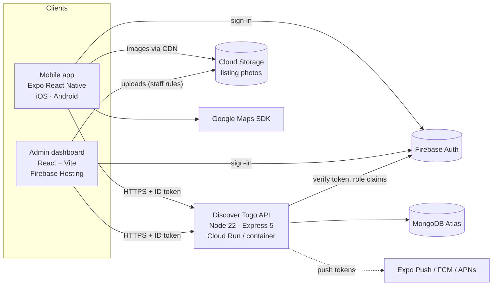
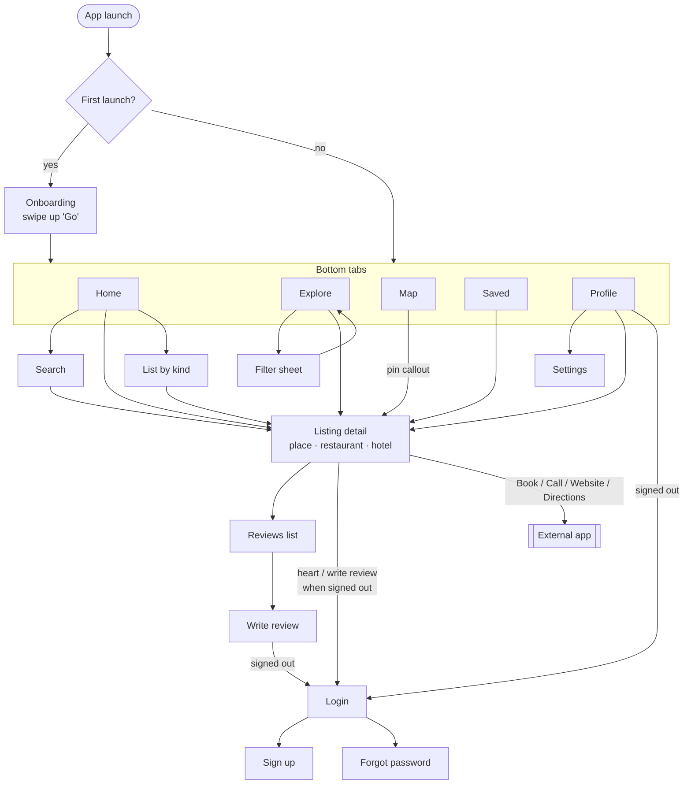

# Architecture, Screens & Navigation

## 1. System overview



| Layer | Choice | Why |
|---|---|---|
| Mobile | **React Native (Expo SDK, expo-router, TypeScript)** | One codebase for iOS and Android (plus a web preview), over-the-air updates, file-based typed routes |
| Data fetching / offline | TanStack Query with an AsyncStorage persister, plus an explicit "saved offline" store | Stale-while-revalidate caching; public data survives restarts and lost connections |
| State | zustand (prefs, offline store) | Small and persisted |
| i18n | i18next (`en`, `fr`; `languages.ts` registry ready for Ewe/Kabiyè) | |
| Backend | **Node.js + Express 5 + MongoDB** | Geo indexes (2dsphere), flexible per-kind documents, mature tooling |
| Auth | **Firebase Auth** (email/password, Google) | The API only verifies tokens and never handles passwords |
| Storage | Cloud Storage with security rules | |
| Admin | React + Vite SPA | Same API with role-gated `/admin/*` routes |

### Backend: ports & adapters

```
routes (HTTP) → middleware (authn, RBAC, validation) → services (schemas, presenters,
recommender, ratings) → Repository port → { MongoRepository | MemoryRepository }
```

- The **memory adapter** runs the full API with seed data and no infrastructure. It is used for demos, the client agents' development and tests.
- The **Mongo adapter** is used in production. Both satisfy the same `Repository` interface (`backend/src/repo/types.ts`).

### Performance

- Compound and 2dsphere indexes match every list filter. Pagination is capped. The map endpoint returns lightweight pins only.
- `Cache-Control: public, max-age` on anonymous catalogue reads (CDN-friendly) and `Vary: Authorization, Accept-Language`.
- Denormalised `rating` / `reviewCount` (O(1) updates) and bounded embedded arrays (favorites, recent).
- **Mobile:** expo-image disk cache, memoised list rows with fixed heights (`getItemLayout`), lazy routes, a debounced search, and a persisted query cache that renders instantly on cold start.

### Monetization hooks (already in the code)

| Hook | Where |
|---|---|
| Sponsored listings | `sponsoredUntil` → `sponsored` badge. Pinned first in home rails; admin UI has a "Sponsorship" panel |
| Bookings | `contact.bookingUrl` → "Book" CTA (affiliate links today; `bookings` collection planned, see DATABASE.md) |
| Ads | `AdSlot` component (off unless `EXPO_PUBLIC_ADS_ENABLED=1`) |
| Premium | `featured` editorial slot; `subscriptions` collection planned |

## 2. Navigation flow (mobile)



Routes (`mobile/app/`): `index` (launch gate), `onboarding`, `(tabs)/{home,explore,map,saved,profile}`, `listing/[kind]/[id]`, `list/[kind]`, `reviews/[id]`, `reviews/write/[id]`, `auth/{login,signup,forgot}`, `search`, `settings`. Route params are validated (24-hex id or slug, known `kind`) before any request.

## 3. Screens breakdown

| Screen | Key UI | Data |
|---|---|---|
| **Onboarding** | Full-bleed hero, "Explore Your Favorite Journey", translucent pill with chevrons, white "Go" button (swipe up or tap), kente accent | Hero image from `/home` |
| **Home** | "Discover" title, search and bell buttons, search bar, hero carousel, category tabs with underline (Featured/Nature/Culture/Beach/City/Adventure), tall rounded cards with info pill + ★ badge, Popular experiences (compact cards, "•••"), Top restaurants, Top hotels, Recommended for you, Explore/Book/Save CTAs, ad slot | `GET /home`, `/recommendations` |
| **Explore** | Places · Restaurants · Hotels switch, search, filter sheet (region/category; city/cuisine/price; location/type/price range/rating; sort), infinite list, pull-to-refresh | `/places`, `/restaurants`, `/hotels`, `/meta` |
| **Map** | Google Map, pins coloured by kind, callouts → detail, kind toggles, near-me | `/map?bbox&kinds` |
| **Detail** | Hero with large rounded corner, back/heart, vertical thumbnail strip, 3 stat boxes (Distance / Fee or Price / Rating), Description + Read more, hours, fee, menu (restaurants), amenities and stars (hotels), call/email/website/Book, mini map + Directions, reviews preview, Save offline, Sponsored badge, price footer + big black arrow button | `/{kind}s/:id`, `/listings/:id/reviews`, `PUT/DELETE /me/favorites/:id` |
| **Reviews / Write review** | Paginated list; 1–5 star picker, 10–1000 chars, handles 409 | `GET/POST /listings/:id/reviews` |
| **Search** | Debounced (300 ms), grouped results, recent searches | `/search` |
| **Saved** | Favorites (synced) + Offline (no network needed), offline banner | `/me/favorites`, local store |
| **Profile** | Avatar, name edit, counts, recently viewed, interests and regions, settings, sign out, delete account | `/me`, `/me/recent`, `PATCH/DELETE /me` |
| **Settings** | Language (System/EN/FR), theme (System/Light/Dark), clear offline data/cache, about and privacy | `PATCH /me` |
| **Auth** | Email/password login, sign-up, reset; Google; dev login (dev only) | Firebase → `POST /auth/session` |

## 4. Admin dashboard screens

Login → Dashboard (stats, top viewed) · Places / Restaurants / Hotels (table + one shared create/edit form per kind) · Reviews (pending/approved/rejected) · Users ★ · Audit log ★ (★ = admin only).

Screenshots: `docs/screenshots/`.
