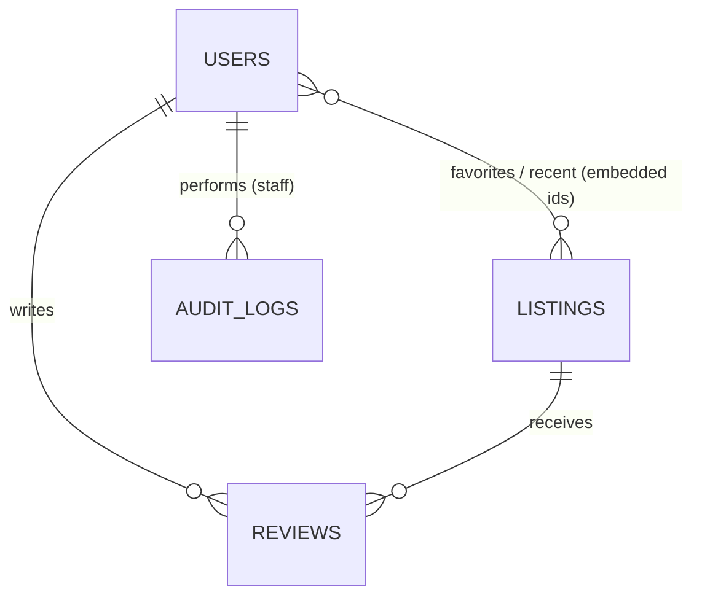

# Database Schema (MongoDB)

Mongoose models are in `backend/src/repo/mongo/models.ts`. The in-memory adapter (`repo/memory.ts`) implements the same `Repository` port for demos and tests.

## Why one `listings` collection

Places, restaurants and hotels share about 80% of their fields: name, location, images, rating, region and so on. Global search, the map, favorites and recommendations all span the three kinds. A single collection with a `kind` discriminator keeps those queries to one index scan, instead of a 3-way fan-out.

## `listings`

| Field | Type | Notes |
|---|---|---|
| `_id` | ObjectId | |
| `kind` | `place \| restaurant \| hotel` | discriminator |
| `slug` | string, **unique** | URL/deep-link key |
| `name`, `description` | `{ en, fr }` | localized; new languages (Ewe, Kabiyè) = new keys |
| `region` | enum (5 regions) | `maritime, plateaux, centrale, kara, savanes` |
| `city`, `cityFolded` | string | `cityFolded` = accent-free lower case for matching |
| `address` | string? | |
| `geo` | GeoJSON Point `[lng, lat]` | **2dsphere** index |
| `images[]` | `{ url, alt? }` | first = cover; https + allow-listed hosts |
| `rating`, `reviewCount` | number | denormalized, updated incrementally on moderation |
| `views` | number | popularity signal (deduplicated per viewer/hour) |
| `tags[]`, `searchText` | string | `searchText` = folded name/city/tags for search |
| `featured` | bool | editorial pick |
| `sponsoredUntil` | Date? | **monetization**: paid placement active while in the future |
| `status` | `draft \| published \| archived` | only `published` is public |
| `contact` | `{ phone, email, website, bookingUrl }` | `bookingUrl` = affiliate/booking hook |
| *place* | `category`, `openingHours{en,fr}`, `entryFee{amount,currency:'XOF',note}` \| null | |
| *restaurant* | `cuisine`, `priceLevel 1–4`, `menu[{name,price,currency,description}]` | |
| *hotel* | `hotelType`, `stars`, `amenities[]`, `priceRange{min,max,currency}` | |
| `createdAt`, `updatedAt` | Date | |

**Indexes:** `{geo: '2dsphere'}`, `{slug: 1}` unique, `{status, kind, views: -1}`, `{status, kind, rating: -1}`, `{status, kind, region, category}`, `{status, kind, cityFolded, cuisine}`, `{status, featured}`.

## `users`

| Field | Type | Notes |
|---|---|---|
| `firebaseUid` | string, **unique** | link to Firebase Auth |
| `email`, `emailVerified` | string, bool | synced from the verified token |
| `displayName`, `photoUrl` | string | |
| `role` | `user \| editor \| admin` | source of truth (mirrored to custom claims) |
| `status` | `active \| suspended` | |
| `preferences` | `{ language, theme, interests[], regions[] }` | drives recommendations |
| `favorites[]` | ObjectId → listings | newest first, capped at 500 |
| `recent[]` | `{ listingId, at }` | capped at 20 (`$push` + `$slice`) |
| `pushTokens[]` | `{ token, platform, updatedAt }` | capped at 5 devices |

Favorites and recent views are embedded because they are bounded, always read together with the user, and need atomic updates (`$addToSet` / `$pull`). If favorites ever need analytics or to grow without limit, move them to a `favorites {userId, listingId}` collection.

## `reviews`

| Field | Type | Notes |
|---|---|---|
| `listingId`, `userId` | ObjectId | **unique compound** index → one review per user per listing |
| `rating` | 1–5 | |
| `comment` | string ≤1000 | sanitized plain text |
| `status` | `pending \| approved \| rejected` | moderation queue |
| `moderatedBy` | ObjectId? | staff user |

Indexes: `{listingId, status, createdAt: -1}` for public pages, `{status, createdAt: -1}` for the moderation queue.

## `auditlogs`

`{ actorId, actorEmail, action, targetType, targetId, ip, meta, createdAt }`. There is a TTL index that removes entries after 2 years.

## Future collections (monetization-ready)

| Collection | Purpose |
|---|---|
| `bookings` | `{ userId, listingId, checkIn, checkOut, guests, amount, currency, status, provider, providerRef }`, filled by a booking provider integration or a payment flow (e.g. Mobile Money: T-Money/Flooz via a PSP) |
| `promotions` | Sponsored-listing campaigns: `{ listingId, slot, startsAt, endsAt, amount, invoiceId }` (feeds `sponsoredUntil`) |
| `subscriptions` | Premium plans (ad-free, offline packs): `{ userId, plan, store, expiresAt, receipt }` |
| `adPlacements` | House ads / partner banners for `AdSlot` components |
